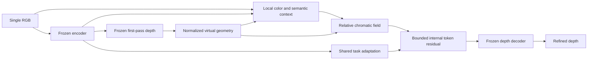

# Phase three: real lighting and explicit chromatic controls

Shirsha Mitra, 2023521460130. Started 7 November 2026.

This follow-up responds to the supervisor's request for a clear CC/depth
relationship, real plus simulated data, larger experiments and a method-level
contribution. The previous studies remain preserved.

## Acquired and verified

- **ReMID:** complete author-published release, 735 real lighting RGBs, 50 capture
  groups, aligned measured depth, native intrinsics and metadata. All raw files
  passed archive CRC and SHA checks. Millimeter depth units and alignment are
  explicit in the native metadata. All images are external evaluation only.
- **NYU:** 368 new real RGB-D scenes, split 200/40/128 for training, validation and
  evaluation. These exclude all forty original-pilot scenes; the split is frozen.
- **PCCC:** original illumination annotations, fold tables and sampled point
  clouds are acquired. These are not claimed to be full native dense depth.
- **Vari:** the existing rendered paired-light evaluation remains a separate
  simulated-scene diagnostic, with its two-room limitation disclosed.

## Research and method

The exact paper mentioned by the supervisor is **Point Cloud Color Constancy,
CVPR 2022**, by Xing, Qian et al. It uses measured RGB-D to estimate illumination.
The student system must estimate depth from a single RGB input. The new model
therefore uses only its own frozen first-pass depth for any geometric context.

**LumiDepth, ECCV 2026** supplies ReMID and is close prior work. Architectural
conditioning and consistency alone are not established novelty. See the
[literature review](research/LITERATURE_REVIEW.md),
[method review](research/METHOD_DESIGN_REVIEW.md) and
[independent protocol review](research/REVIEW_PROTOCOL.md).

The new prototype has an explicit relative-chromatic cue, bounded internal
low-rank residuals and a predicted-geometry branch. It retains ordinary task
adaptation in every learned mode. A known-gain relative-chroma loss is compared
with its ablation and with matched appearance-robustness controls. Module
identity, gradients, pseudo-geometry scale invariance and unclipped
luminance-preserving interventions passed preflight checks.

Validation motivated a second, local geometry/chroma coupling. It uses predicted
depth boundaries to guide a relative chromatic field and compares flat geometry,
generic content and both loss ablations. Additional loss-matched controls were
locked from validation evidence before final-score inspection. Read
[the local experiment](SPATIAL_EXPERIMENT.md) and
[the input-precision probe](FLOAT_PROBE.md).



## Completed results

All fifteen learned variants and the frozen model are evaluated. The independent
auditor recomputed all **26,224** unique main predictions and **640** floating-point
probe predictions, with zero disagreement in the saved metrics.

The full local primary has digital-color AbsRel **0.1623** versus **0.1944** for
ordinary adaptation, but local content is slightly better at **0.1618**.
Validation selected the no-equivariance recipe before test inspection. Its
NYU native AbsRel is **0.1510**; its captured ReMID group error worsens to
**0.4848** versus **0.4246** for loss-matched content. A reliable CC-specific
benefit and architectural/loss novelty remain unproven.

Read [the measured results and interpretation](RESULTS.md),
[all sixteen methods](results/combined/comparison_table.csv),
[paired intervals](results/combined/paired_comparisons.json),
[the independent audit](results/combined/independent_audit.json), and
[the weekly PDF](../output/pdf/Shirsha_Mitra_Weekly_Update_2026_11_07.pdf).
The [short English professor message](../output/QQ_Weekly_Update_2026_11_07_English.txt)
summarizes progress and the remaining problem.

## Reproduce

Run from the project root with the existing isolated environment:

```powershell
& .\.venv\Scripts\python.exe phase3/data_tools/acquire_real_data.py
& .\.venv\Scripts\python.exe phase3/data_tools/prepare_remid_manifest.py
& .\.venv\Scripts\python.exe phase3/nyu_acquire.py
& .\.venv\Scripts\python.exe phase3/learning/model_checks.py
& .\.venv\Scripts\python.exe phase3/learning/study.py cache
& .\.venv\Scripts\python.exe phase3/learning/study.py train
& .\.venv\Scripts\python.exe phase3/learning/spatial_study.py train
& .\.venv\Scripts\python.exe phase3/learning/spatial_controls.py train
& .\.venv\Scripts\python.exe phase3/run_verified.py global
& .\.venv\Scripts\python.exe phase3/run_verified.py spatial
& .\.venv\Scripts\python.exe phase3/float_probe.py
& .\.venv\Scripts\python.exe phase3/finish_study.py
```

Read [the locked numerical configuration](EXPERIMENT_V1.md) before interpreting
scores. Caches verify RGB hashes, source/transform identity, upstream revision,
input size and base checkpoint. Results refuse a changed configuration; choose
a new result directory for a new numeric experiment. Raw data, large prediction
arrays and caches stay local, with source identities and hashes versioned.

The coordinator records the best NYU-validation recipe, evaluates the remaining
loss-matched controls, combines all complete runs, audits saved predictions and
builds the weekly PDF. Avoid launching a duplicate coordinator while another is
running. For the conceptual explanation, read [the student guide](STUDENT_GUIDE.md).
