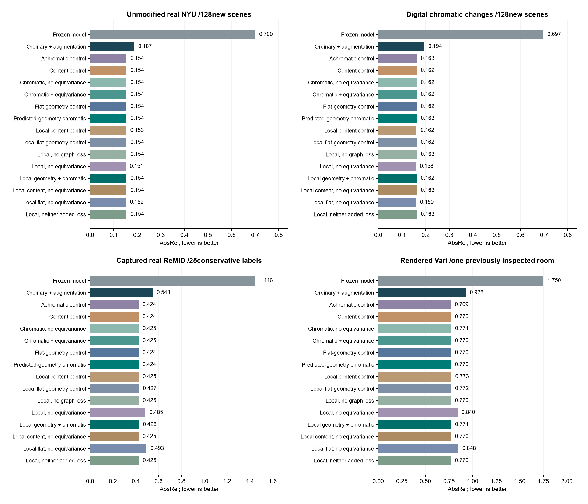

# Measured results: real lighting and explicit chromatic controls

Shirsha Mitra / 2023521460130 / 7 November 2026.

**The expanded experiment is complete. A reliable CC-specific depth benefit is
not established.** The full local module improves over ordinary adaptation, but
does not beat the stronger content control. The validation-selected recipe has
a small NYU gain and a substantial real-data transfer failure. These negative
results are retained rather than presenting the best test score as a discovery.

Read the [six-page weekly PDF](../output/pdf/Shirsha_Mitra_Weekly_Update_2026_11_07.pdf)
and the [plain-English explanation](STUDENT_GUIDE.md).

## Data and completed computation

- **368 new NYU scenes:** 200 training, 40 validation and 128 test, one frame per
  scene, with the official train/test membership retained. All forty pilot
  scenes are excluded. Digital color/exposure changes simulate illumination on
  real photographs; they are not captured relighting.
- **735 captured real-light ReMID images:** 50 captures, shared aligned measured
  depth, native units verified as millimeters. All images are external to
  training and checkpoint selection. Equal-capture then equal-label averaging
  uses 25 conservative labels, whose physical-room independence is unknown.
- **264 rendered Vari images:** the previously inspected evaluation room, used
  only as an exploratory simulation diagnostic.
- **15 trained variants plus the frozen model:** seven global and eight local
  recipes, the same 600 paired-update schedule, source data and validation rule.
  The local model has 42,036 trainable parameters; inference receives one RGB.
- **26,224 unique main predictions**, plus a separate **640-prediction**
  floating-point probe. The [independent audit](results/combined/independent_audit.json)
  recomputed AbsRel, RMSE and delta1 from every native saved prediction with
  maximum numerical disagreement **0.0**. It also checked source/input hashes,
  checkpoint selection, parameter counts and scene splits.

The [selection record](results/development_selection.json) was written from NYU
validation histories before final-test inspection. The fixed full-loss primary
is `spatial_geometry_eq`; validation selected `spatial_no_equivariance`.
All sixteen methods remain in the [complete table](results/combined/comparison_table.csv)
and [per-prediction metrics](results/combined/metrics.csv).

## Accuracy and the important controls

AbsRel is relative depth error; lower is better. ReMID below uses conservative
group macro averaging, not the unequal per-image mean. NYU digital color is the
average of two fixed chromatic interventions.

| Method | NYU native | NYU digital color | ReMID groups | Vari rendered |
|---|---:|---:|---:|---:|
| Frozen model | 0.7001 | 0.6968 | 1.4456 | 1.7497 |
| Ordinary augmented adaptation | 0.1871 | 0.1944 | 0.5480 | 0.9281 |
| Global brightness control | 0.1540 | 0.1625 | 0.4239 | 0.7690 |
| Local content, full losses | 0.1531 | 0.1618 | 0.4252 | 0.7732 |
| Local flat geometry, full losses | 0.1537 | 0.1622 | 0.4271 | 0.7717 |
| **Fixed full-loss primary** | **0.1538** | **0.1623** | **0.4276** | **0.7714** |
| Validation-selected, no equivariance | 0.1510 | 0.1585 | 0.4848 | 0.8396 |
| Loss-matched content, no equivariance | 0.1540 | 0.1626 | 0.4246 | 0.7703 |
| Loss-matched flat geometry, no equivariance | 0.1518 | 0.1594 | 0.4930 | 0.8485 |
| Local, neither added loss | 0.1540 | 0.1626 | 0.4259 | 0.7699 |

1. **Adaptation helps, but that is not a CC mechanism result.** The full primary
   reduces digital-color AbsRel from 0.194378 to 0.162296 versus ordinary
   adaptation, a 16.50% relative reduction. Its paired difference is -0.032082
   (scene-bootstrap interval -0.044845 to -0.019823).
2. **The full hypothesis loses to stronger controls.** Local content obtains
   0.161833 on digital color, slightly better than the primary's 0.162296.
   The primary-minus-content difference is +0.000464 (interval +0.000189 to
   +0.000795). The real ReMID primary also loses to flat geometry: +0.000448
   group AbsRel (conditional interval +0.000081 to +0.000883).
3. **Source validation does not ensure real transfer.** The validation-selected
   no-equivariance recipe has NYU native AbsRel 0.150977 versus 0.153989 for
   loss-matched content. Their -0.003012 difference has an interval spanning
   zero (-0.010382 to +0.004731). ReMID group error worsens to 0.484845 versus
   0.424612: +0.060233, or 14.19% higher relative error. It loses to that
   content control in all 25 conservative labels.
4. **Predicted geometry gives a small, conditional gain in one recipe.** The
   selected recipe beats its loss-matched flat variant by 0.000848 NYU native
   AbsRel (interval -0.001489 to -0.000221), and 0.008126 ReMID group AbsRel
   (conditional interval -0.010431 to -0.005930). Both remain worse than the
   content control on real ReMID. This is not evidence of a general CC benefit.

Intervals use 5,000 paired resamples of entire NYU scenes or conservative ReMID
labels. ReMID intervals are conditional descriptions, not population inference
about independent rooms. One training seed is used; these intervals do not
measure training variation and are not adjusted for multiple comparisons.
Exact results are in [paired comparisons](results/combined/paired_comparisons.json).

## Does color alone disturb depth?

The separate frozen-model floating-point probe applies chromatic gains after
fixed spatial resampling. It removes eight-bit rounding from the controlled
encoder inputs and measures maximum relative luminance drift of **1.30e-7**.

| Intervention versus matched neutral | Mean AbsRel change | Paired 95% interval |
|---|---:|---:|
| Chromatic changes | +0.003105 | -0.005743 to +0.011387 |
| Scalar exposure | +0.006350 | +0.003876 to +0.008878 |

The chromatic interval includes zero. It does not establish an average
color-specific error increase for this frozen model and these interventions;
it also does not prove that color never matters. Exposure sensitivity is clearer
in this particular probe. These results do not settle real mixed-illumination
behavior or other depth models.

The main learned-method experiment deliberately preserves its original eight-bit
pipeline. Its measured maximum brightness drift is **0.6284%**, with no clipping.
Do not call that pipeline perfectly brightness matched.

The full primary has a small reduction in chromatic-minus-neutral error versus
local content: -0.000245 (interval -0.000463 to -0.000043). This response
interaction coexists with worse overall color-input accuracy and real transfer;
it does not establish the requested useful CC-specific improvement.

## Stability, qualitative evidence and limits

On real ReMID, group-macro lighting instability is 0.1201 for the full primary
versus 0.1177 for local content; lower is better. It is normalized prediction
deviation across fixed-capture lights, not an accuracy metric. A stable but
incorrect map cannot count as success. Full stability and worst-deviation scores
are in [the table](results/combined/lighting_stability.csv).

The [real-light evidence](results/combined/figures/remid_depth_evidence.png) and
[NYU evidence](results/combined/figures/nyu_depth_evidence.png) use the first
sorted native evaluation image, without error-based selection. Shared color
scales and invalid-reference masks are documented in the PDF.

This is a **224-pixel CPU adapter study**, not a full-resolution published
benchmark comparison. The frozen zero-shot baseline is weak under this setup;
large gains over it are not state of the art. Previous 518-pixel pilot scores
use different scenes and must not be treated as a matched comparison.
The virtual geometry comes from predicted depth and normalized rays, not
measured world coordinates. Absolute illuminants are not calibrated.

PCCC labels/folds/sampled clouds were acquired but not silently used for dense
depth or claimed as a reproduced baseline. LumiDepth is close prior work.
Architecture and loss innovation, full-resolution competitive comparisons and
robust CC-specific gains remain unresolved.

## Next research decision

1. Show the supervisor both the useful adaptation gain and the real-data failure.
   Discuss the coupling/loss mechanism before claiming a new algorithm.
2. Prioritize a matched published lighting-robust depth baseline and stronger
   illumination supervision, after auditing label indexing and color spaces.
   Repeat a chosen development recipe with independent seeds and resolution
   controls; GPU access would make full-resolution training more practical.
3. If the method changes after these results, ReMID/NYU test evidence becomes
   development evidence. Reserve a new, scene-grouped real dataset for final
   confirmation rather than repeatedly choosing a method on this test set.

See the [paper plan](PAPER_PLAN.md), [literature review](research/LITERATURE_REVIEW.md)
and [locked experimental protocol](EXPERIMENT_V1.md).
