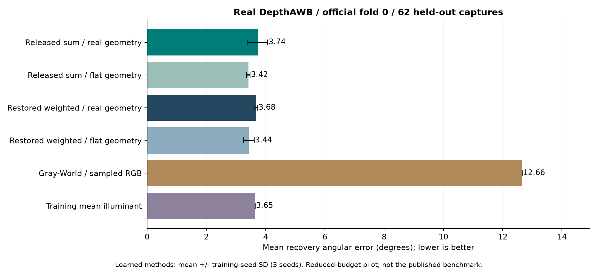
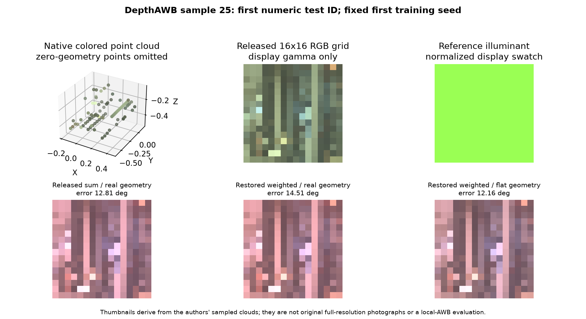
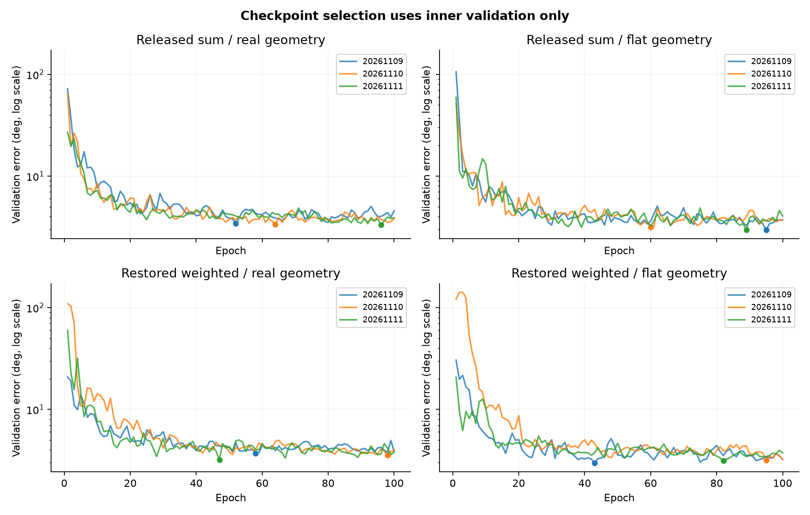

# Small PCCC reproduction: measured results

Shirsha Mitra / 2023521460130 / 9 November 2026.

**Completed: an adapted, reduced-budget CPU reproduction on genuine PCCC DepthAWB data.** This is not a reproduction of the complete published benchmark or its accuracy.

## What actually ran

- All 185 original released DepthAWB samples, each with 256 XYZRGB points and its illumination label.
- 98 training / 25 inner validation / 62 final test samples. Official fold 0 is final test; it was never used to select a checkpoint.
- Four predeclared variants, three training seeds each: 12 trained models, 100 epochs/model, 8 CPU threads.
- The original authors' PointNet, STN, point-wise network and angular loss are executed from a pinned, unmodified clone.
- Both the released three-channel sum head and an explicit restoration of the paper's four-channel weighted head are reported.
- 868 held-out predictions across the 12 trained models and 2 non-neural baselines. All angular scores were independently recomputed; all saved models were re-evaluated to verify their predictions.

The [protocol](PROTOCOL.md), [source wrapper](upstream.py), [data identities](manifest.json), [preflight](preflight.json) and [independent audit](results/cpu_v1/independent_audit.json) specify the exact scope.

## Global illumination estimation

Recovery angular error is in degrees; lower is better. Learned rows average the three separately selected seeds. The +/- value is sample standard deviation across training seeds, not an interval over independent scenes.

| Method | Mean +/- seed SD | Median | Trimean | Worst 25% |
|---|---:|---:|---:|---:|
| Released code / real geometry | 3.738 +/- 0.334 | 2.850 | 2.978 | 7.815 |
| Released code / flat geometry | 3.419 +/- 0.060 | 2.533 | 2.561 | 7.623 |
| Restored paper-weighted / real geometry | 3.683 +/- 0.048 | 2.490 | 2.698 | 8.312 |
| Restored paper-weighted / flat geometry | 3.438 +/- 0.176 | 2.499 | 2.518 | 7.650 |
| Gray-World on sampled RGB | 12.660 | 12.443 | 12.495 | 14.257 |
| Training-mean illuminant | 3.648 | 2.681 | 2.644 | 8.204 |

**Main finding:** under this 100-epoch pilot, native geometry does not beat flat geometry on average in either family. Both paired capture-bootstrap intervals include zero. The full-geometry models also do not improve on the strong training-mean baseline on average. A useful geometry benefit has not been established; this does not invalidate the original paper or identify the reason for the gap.

See [every individual seed](results/cpu_v1/per_seed_metrics.csv) and [every prediction](results/cpu_v1/predictions.csv). The author cosine clamp is retained; its minimum angular error is approximately 0.081 degrees. Best/worst quartiles use the original integer-slice convention.

## Does genuine geometry help in this pilot?

The flat control retains the same RGB values, camera rays and invalid-geometry mask. It removes valid relative ranges by setting native Z to -1, then applies the same training augmentation. It is not a pure RGB-only model.

| Family | Real minus flat mean error | Conditional capture-bootstrap interval |
|---|---:|---:|
| released | +0.319 deg | -0.033 to +0.653 deg |
| weighted | +0.245 deg | -0.046 to +0.547 deg |

Negative differences favor native geometry. Intervals resample 62 test captures after averaging the three seed-wise paired differences. They are conditional on these trained seeds and captures. Unknown physical room identities prevent claims about room-independent population generalization. Read the [per-seed differences](results/cpu_v1/geometry_effects.json), including reversals.

## Comparison with the original paper

The original CVPR 2022 Table 2 reports **1.05 degree mean / 0.37 degree median** for DepthAWB at 256 points, and 2.39 degree mean for its no-depth 256-point variant. These are reference values, not matched results for this pilot. The paper states 10000 training epochs and broader evaluation; this experiment uses 100 epochs, one outer fold and inner-validation checkpoint selection. Its native-coordinate flat control also preserves missingness rather than rebuilding the complete RGB-D input. **The published numerical accuracy has not been reproduced.**

The released model and training entry point do not implement the paper's explicit fourth-channel certainty head. The restored weighted variant documents this change rather than silently labelling the released sum as the paper algorithm. The families additionally differ in intensity augmentation SD 0.20 (release) versus 0.15 (paper), so their comparison cannot isolate weighting alone.

## Actual source-data example

The example is the first numeric final-test ID, using the first predeclared seed. No sample or seed was selected for low error. The 16x16 thumbnails reshape the released sampled colors; they are not full-resolution photographs. Reference labels are global illuminants, so these images do not establish spatial multi-illumination accuracy.

## Laptop use and retained evidence

The twelve training runs took 14.8 minutes in total, excluding setup, timing, audit and analysis. Each model has about 1.68 million trainable parameters. The measured timing probe and environment are in [benchmark.json](benchmark.json) and [runtime.json](runtime.json). The runtime memory value is a single process-RSS snapshot, not peak RAM.

Code, split IDs, hashes, histories, test predictions, audit and figures are suitable for publication. Original data and the unmodified upstream clone remain local. The first predeclared seed checkpoint of each variant is published; the other eight checkpoints remain local to keep the repository lightweight. All twelve SHA identities and metrics are retained.

## What this establishes and what comes next

The original released PCCC pipeline now runs on this CPU laptop with genuine illumination labels. It produces an auditable CC result, rather than substituting the previous monocular-depth experiment. The real/flat comparisons describe the contribution of native geometry only under this reduced protocol.

Next, discuss the results with the supervisor, then predeclare a longer-budget/all-fold study. If this test result guides a method change, treat it as development evidence and reserve a fresh outer fold or independent real dataset for confirmation. Multi-light work requires suitable local illuminant labels and a stronger prior-art comparison. No novel method or state-of-the-art result is claimed.

Primary references: [author code/data](https://github.com/xyxingx/Point-Cloud-Color-Constancy), [paper manuscript](https://arxiv.org/abs/2111.11280).
